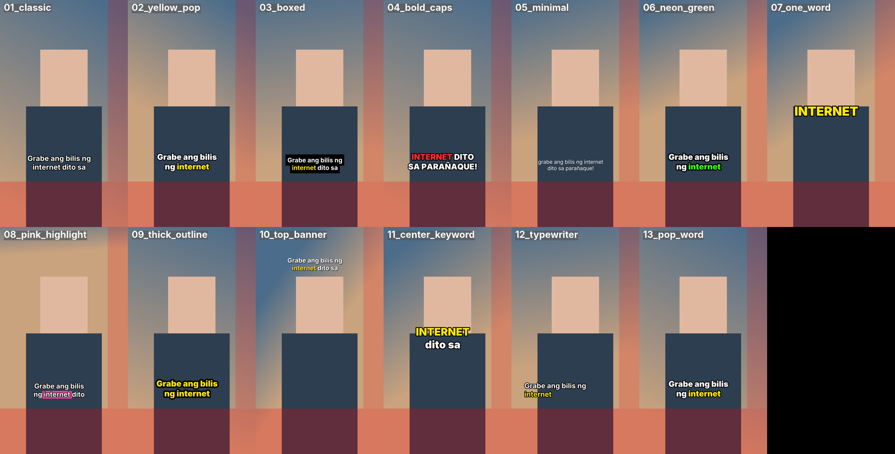

# Auto Video Editor (TikTok / Facebook Reels)

Drop in a raw vertical talking video (Filipino / Taglish) and get back a finished
**1080x1920 MP4**: pauses and "uhm"s cut out, jump-cut zooms, colour grade, louder
and even audio, and word-by-word captions. It runs on your own Windows PC with free
tools only (Python + FFmpeg). No paid editor, no subscription.

```
python editor.py edit inbox\myvideo.mp4 --style 2
```

What it does, in order:

1. **Transcribes** the speech with word timings (Groq Whisper online, or offline on your PC).
2. **Cuts pauses** longer than 0.25 s and **filler words** (ah, uh, um, uhm, eh), keeping a
   little air (80 ms) around each cut so words don't sound clipped.
3. **Jump-cut zoom**: alternates between normal and 115% every few seconds.
4. Makes it **1080x1920, 30 fps, H.264 + AAC** (crops to fill the screen, never stretches).
5. **Loudness** evened out to about -14 LUFS (what TikTok/Reels like).
6. **Colour grade** (natural_clean by default).
7. **Captions** burned in, in one of 13 styles, kept away from the app's buttons.
8. Optional **intro/outro**, **logo watermark**, **pop-in images** when you say a keyword,
   **sound effects**, and **screen recording** layouts.

Every edit is also saved as a **project file** (`output\myvideo_edited.project.json`): the
whole timeline (cuts, zooms, captions, overlays, sounds) as tracks and clips. You can
re-render it, and the desktop editor that is being built will open it so you can change
anything by hand. See [Project files](#project-files).

> **New: AI edit and desktop app.** Describe the finished video in plain Taglish or English
> ("mabilis na edit, malaking captions, ipakita ang receipt.png pag sinabi kong resibo") and
> the AI plans the edit, the editor builds and renders it, and tells you in plain words what
> it did. One click undoes it. Works for a batch of videos too. See
> [The AI edit and the desktop app](#the-ai-edit-and-the-desktop-app). The full multi-track
> timeline editor comes later; the app has a preview player for now.

---

## What was tested, and what was not

Be aware of what has and has not been checked:

**Tested (automatically, on Linux with FFmpeg 6.1, Python 3.13):**
- 320 automated tests pass (`python -m pytest`): cutting maths, timestamp remapping,
  keyword rules, settings, edit plans, watch mode, and all 13 caption styles. Each style
  is turned into a subtitle file and drawn by FFmpeg/libass to check that text appears.
- **Project files:** the schema and ~30 kinds of mistakes (each with a clear message);
  saving and loading; and rendering synthetic projects checked **frame by frame** by
  colour: clip edges land on the exact frame, reordered clips, gaps, stills, pop-in
  photos, colour grade ranges, export sizes, volume/mute/fades and sound placement.
- **The auto edit through a project gives the same video as before.** Rendering the
  synthetic edit through its project and through the original renderer gives the same
  frames and the same sound (checked in the tests; without an intro/outro the decoded
  frames and audio samples were identical). All 13 caption styles produce exactly the same
  subtitle file as before.
- `render`, `frame`, `validate`, JSON progress, and **cancel** (FFmpeg is stopped, no
  half-written file is left).
- **AI edit** (with the AI's answers faked, because no AI service could be reached from the
  test machine): plan checks, the exact requests sent to Groq and Anthropic, clear errors,
  one retry with the problems listed, falling back to the preset edit (and saying so) after
  two bad plans or when the AI cannot be reached, saved transcripts and plans, cost
  estimates, and the whole flow to a rendered video, including review mode, follow-up
  changes and batches. See [docs/ai-edit.md](docs/ai-edit.md).
- **Timeline editor:** every editing action (split, trim, delete, move, reorder, speed,
  settings, adding media) is a pure function with unit tests. **3,600 random edits** (300
  sequences of 12) were each checked by the engine's own validator: all gave valid project
  files. Speed, reframe and sound fades are checked frame by frame and sample by sample in
  real FFmpeg renders. The preview's reframe lands within about 1 pixel of the engine's frames.
  10 browser tests drive the editor; the projects it saves are validated by the engine. The
  main process opens, saves, reads media and exports with the real engine (size, frame rate,
  progress, cancel). See [docs/timeline-editor.md](docs/timeline-editor.md).
- **Captions, sound and effects in the editor:**
  - **Effects** are checked pixel by pixel in real renders (shake, flash, dip to black,
    glitch, whip blur, smooth zoom and colour strength).
  - **Ducking** is measured: the music is more than 2.5× quieter while the voice plays,
    and back to normal after.
  - **Noise reduction** is measured: hiss more than 5× lower, with the voice kept.
  - **Vocabulary corrections** give the same result in the app and in the engine.
  - **"Listen again"** maps words through sped-up clips correctly (tested with a fake
    transcriber).
  - A **voice-over recorded in Chromium** (fake microphone) is saved, measured and rendered.
- **Desktop app:** 218 unit tests (including the app's main process driving the real
  engine from start to finished video, undo/redo, exact frame) and 40 browser tests of the
  window (Playwright, at 1280x800 and 1920x1080, with screenshots checked by eye): Auto mode
  on by default and rendering with no extra clicks, live progress, the summary and cost,
  undo/redo, review with Auto mode off, the fallback warning, keys never shown, the
  consent notice, the live preview playing the planned edit, and the AI models window
  (tiers, Compare, per-video limits). The preview's captions
  and photos land where the engine draws them (checked against frames the engine rendered).
- **B-roll and effects:** matching your B-roll folder, the order folder → stock → AI,
  Pexels/Pixabay requests and downloads with **faked answers** (no network), credits and
  licences kept, keys never printed, AI B-roll with the stand-in WanGP, AI-planned effects
  landing on the right moment, and the editor's find another / regenerate / replace (3
  browser tests; the editor's B-roll clips match the engine's and pass its validator). Real
  Pexels/Pixabay calls were **not** made. See [docs/broll.md](docs/broll.md).
- **Tracked effects:** following a hand/face point (gaps, smoothing, fading out when lost) with
  synthetic tracks, the detector run with a stand-in MediaPipe, and the effects **measured on
  rendered pixels** (they land on a marker through fill, reframes, zooms, speed and cuts, and only
  add light). The real MediaPipe ran on **one real photo only** (a plumbing check). **Not
  tested: real talking videos**, so how well hands are followed and how the effects look on your
  footage is unknown. See [docs/tracking.md](docs/tracking.md).
- **Motion graphics (47 templates) and the Director:** every template drawn by a real Chromium
  and checked on its pixels (Taglish, *ñ*, emoji, long words); the compositing measured on
  rendered frames; the Director's rules (sync to word frames, density, variety, mood, face-safe
  on synthetic face tracks, caption-safe, readability) with a stand-in AI. **Not verified:**
  Electron's hidden drawing window (no Electron here), real Taglish speech with a real AI, how the
  templates look on your videos, Windows and speed. See [docs/graphics.md](docs/graphics.md).
- **Video formats (13, data-driven):** each format's layout, cut-outs, numbers, wipes and sounds
  measured on rendered frames; Clone and "green screen without a green screen" only with a
  **stand-in** person segmenter. **Not verified:** the real MediaPipe segmenter on real footage,
  real Taglish speech, Windows and speed. See [docs/formats.md](docs/formats.md).
- **Storyboard and 7 presets:** the scenes, lock, word edits and regenerate checked to agree
  between the engine and the app, presets' settings, music and sounds, and the app's storyboard
  and preset menu (browser build, stand-in engine). **Not verified:** Windows/Electron, real
  speech, how the presets look on your videos. See [docs/storyboard-presets.md](docs/storyboard-presets.md).
- **Polish command, watch folder and quality checks:** every check passes on a good video and
  fails on one made with exactly that problem; the automatic fix; polish with the real AI edit
  (stand-in AI); the watch folder (half-copied files, failures with logs, restarts, one job at a
  time). **Not verified:** Windows file locking, Task Scheduler, real workers, long videos. See
  [docs/polish.md](docs/polish.md).
- **AI pictures, clips and voice-over with WanGP** (quality tiers, hardware detection,
  tests, Compare, Auto mode's tier choice and fallback), tested **only against a stand-in
  for WanGP and a fake `nvidia-smi`**: there is no GPU on the test machine. See
  [docs/generation.md](docs/generation.md).
- Full edits of a **synthetic test video** (colour bars + beeps standing in for speech, with a
  fake transcript): output is 1080x1920, 30 fps, H.264, with an AAC audio track, and sound
  and picture have the same length. Layouts tested: face, split screen, picture-in-picture,
  screen only. Pop-in overlays, plan zooms/grades, watermark, intro and sound effects tested too.
- Preview pictures of all 13 caption styles were rendered and looked at
  (see `docs/caption_styles.png`).
- The Groq request was checked with a fake server (correct address, model, language
  `tl`, word timestamps, key not printed).

**Not tested:**
- **Real speech:**
  - how well "listen again" and the vocabulary hint work on real Taglish speech (no
    transcriber could be reached here);
  - noise reduction and ducking on real recordings (only synthetic tones and white noise
    were measured);
  - recording with a real microphone (only Chromium's fake microphone).
- **The timeline editor inside the real Electron window on Windows:**
  - mouse dragging, file drops from Windows Explorer, the save dialog;
  - playing MP4 (H.264) in the preview: the tests use a browser that has no H.264, with WebM copies.

  The tests ran in Chromium with the Electron parts stood in, and the main process ran in Node
  on Linux. Long projects (an hour of clips) and their timeline speed were not measured.
- **Real Filipino/Taglish speech.** How well Whisper hears Taglish, and how natural the cuts
  feel on a real voice, has not been checked. Try a short video first and adjust
  `silence_threshold` / `padding` in `config.yaml` to taste.
- **Real Groq API calls** (no API key was available).
- **faster-whisper (local transcription)**: it was not installed or run here.
- **Windows.** The code avoids the usual Windows problems (long command lines, `C:` drive
  paths in FFmpeg filters), but it was not run on a Windows PC. Speed on your PC is unknown.
  Expect the export to take roughly as long as the video, or longer on older laptops.
- FFmpeg 7/8 (Windows builds are usually newer than the 6.1 used for testing). The editor
  switches to the newer way of passing the filter file automatically.
- **Real Groq and Anthropic calls**: no AI service could be reached from the test machine,
  so how well the AI plans real Taglish videos is unknown. The Groq model name
  (`openai/gpt-oss-120b`) and Groq prices could not be checked either; change them in
  Settings / `config.yaml` if Groq says the model does not exist.
- **The desktop app inside Electron.** Electron itself could not be downloaded on the test
  machine, so the app window was tested in a browser (Chromium) with the Electron parts
  stood in, and the app's main process was tested in Node. Never run: the real Electron
  window, file dialogs, drag and drop, key encryption (safeStorage), playing MP4 files in
  the app, and quitting during a render.
- The live preview is close to the final video but not identical (fonts, outlines and
  colour grades are drawn by the browser). Use **Exact frame** to see the real thing.
- **Real WanGP, real benchmarking and output quality.** WanGP needs an NVIDIA GPU, so it was
  never run here. Real generation times, out-of-memory behaviour, peak VRAM, GPU detection
  on real hardware and how good any model's pictures, clips or voice sound are all
  **unverified**. Test on your PC with **AI models > Test everything** and judge the
  outputs with **Compare**.
- No installer yet (Phase 4).
- Cancelling on **Windows** (the app stops FFmpeg through the editor) was only tested on
  Linux.

If something breaks, the error message says what went wrong. The temporary files are
kept in `work\` so you can see what happened.

---

## Setup on Windows (step by step, one time)

### 1. Install Python

1. Go to <https://www.python.org/downloads/> and download Python **3.11 or newer**.
2. Run the installer. **On the first screen, tick "Add python.exe to PATH"**, then
   click *Install Now*.

### 2. Install FFmpeg

1. Click the Start menu, type `powershell`, and open **Windows PowerShell**.
2. Type this and press Enter:
   ```
   winget install Gyan.FFmpeg
   ```
3. **Close PowerShell and open it again** (so it finds the new program).
4. Check that it works: type `ffmpeg -version` and press Enter. You should see a version number.

> No `winget`? Download the "full" build from <https://www.gyan.dev/ffmpeg/builds/>,
> unzip it to `C:\ffmpeg`, and add `C:\ffmpeg\bin` to your PATH
> (Start → "Edit the system environment variables" → Environment Variables → Path → New).

### 3. Get this project

On the GitHub page click **Code → Download ZIP**, unzip it, e.g. to
`C:\Users\<you>\Videos\autoeditor`. (Or `git clone` it if you use Git.)

### 4. Open a terminal in the project folder

Open the project folder in File Explorer, click the address bar, type `powershell` and press
Enter. A blue window opens already inside the folder.

### 5. Install the Python parts

```
python -m pip install -r requirements.txt
```

(This also installs the offline transcriber `faster-whisper`, which is a big download. If
you will only use Groq, you can skip it: `python -m pip install PyYAML requests Pillow jsonschema pytest`.)

### 6. Add your Groq API key (for online transcription)

1. Make a free account at <https://console.groq.com> and create a key at
   <https://console.groq.com/keys>.
2. In the project folder, copy `.env.example` and rename the copy to **`.env`**
   (Windows may warn about changing the extension; click Yes).
3. Open `.env` with Notepad and replace `your_groq_api_key_here` with your key:
   ```
   GROQ_API_KEY=gsk_...your key...
   ```
4. Save. **Never share this file.** It is in `.gitignore`, so Git will not upload it.

Prefer fully offline? Skip this step and set `provider: local` in `config.yaml`
(slower; the first run downloads the model, about 1.5 GB for "medium").

### 7. Check everything

```
python editor.py check
```

You should see `OK` lines for FFmpeg and your key.

---

## Everyday use

### Edit one video

```
python editor.py edit inbox\myvideo.mp4
python editor.py edit inbox\myvideo.mp4 --style 11 --grade warm
python editor.py edit inbox\myvideo.mp4 --style bold_caps --preset relaxed
```

The finished video goes to `output\myvideo_edited.mp4`.

| Option | What it does |
|---|---|
| `--style N` | caption style, number 1-13 or name (see below) |
| `--grade NAME` | `natural_clean`, `none`, `warm`, `black_and_white`, `orange_teal`, `high_contrast` |
| `--lang tl` | speech language (default `tl`, Tagalog/Filipino; Taglish works) |
| `--preset fast` | pacing preset from `config.yaml` (`fast` or `relaxed`, or add your own) |
| `--provider groq` / `local` | online or offline transcription |
| `--transcript file.json` | skip transcription and use this transcript |
| `--plan plan.json` | extra instructions for this video (see "Edit plan") |
| `--screen rec.mp4` | add a screen recording (see "Screen recordings") |
| `--layout split/pip/screen` | screen recording layout |
| `--silence 0.4` | cut pauses longer than 0.4 s (overrides the preset) |
| `--zoom 1.2` | punch-in zoom amount (overrides the preset) |
| `--no-captions` | no captions |
| `--output path.mp4` | save somewhere else |
| `--keep-work` | keep the temporary files in `work\` |

### Re-render or check a project file

```
python editor.py render output\myvideo_edited.project.json
python editor.py render output\myvideo_edited.project.json --height 1280 --crf 23
python editor.py frame output\myvideo_edited.project.json --time 12.5
python editor.py validate output\myvideo_edited.project.json
python editor.py edit inbox\myvideo.mp4 --project-only
```

`render` saves `myvideo_edited_render.mp4` next to the project (`--height 1280` = 720x1280,
`960` = 540x960). `frame` saves the exact picture at 12.5 s as a PNG. `--project-only`
makes the project without rendering. See [Project files](#project-files).

### Fix the transcript and re-run (no new transcription)

Every edit saves `output\myvideo.transcript.json`. Open it in Notepad to fix a misheard word,
or wrap a word in stars like `"*GitHub*"` to force it to be a highlighted keyword. Then:

```
python editor.py edit inbox\myvideo.mp4 --transcript output\myvideo.transcript.json
```

Only change the words, not the numbers. The format is:

```json
{"language": "tl", "words": [
  {"word": "Kumusta", "start": 0.50, "end": 0.90},
  {"word": "*GitHub*", "start": 5.50, "end": 6.00}
]}
```

### Watch a folder (automatic)

```
python editor.py watch
```

Leave it running. Every video you drop into `inbox\` is edited with your `config.yaml`
settings, and the original is moved to `inbox\done\` (or `inbox\failed\` if something went
wrong; fix the problem and move it back into `inbox\`). Stop with **Ctrl+C**.

### See all caption styles

```
python editor.py styles
python editor.py styles --video inbox\myvideo.mp4     # use a frame from your video
```

Pictures are saved in `output\style_previews\`. The red areas show where TikTok/Reels put
their buttons and text; captions stay out of them.

---

## The AI edit and the desktop app

### In the app

Setup: see [desktop/README.md](desktop/README.md) (Node.js, then `npm install` and
`npm start` in the `desktop` folder). Then:

1. **Settings**: paste your Groq key (free). Optionally an Anthropic key (paid). Keys are
   encrypted on your PC and never shown again.
2. **Add videos** (one or many) and, optionally, **Add photos** the AI may pop in. Name
   photos well (`gcash_receipt.png`), because the AI matches names to what you say.
3. Type what you want, e.g. *"Mabilis na edit, malaking yellow captions, tanggalin ang
   retake sa simula, ipakita ang gcash_receipt.png pag sinabi kong resibo."*
4. Click **Edit with AI**. With **Auto mode** on (the default) everything happens
   by itself: transcript, plan, cuts, zooms, captions, photos, render. Each step lights up
   as it finishes, and the preview fills in.
5. Read **What the AI did**: a plain list of the changes, anything it could not do, and the
   API cost.
6. Not happy? **Undo AI edit** (instant, back to the previous version or the original),
   **Redo with new instructions**, or type a change like *"mas malaki pa ang captions"* and
   click **Change**.

With **Auto mode off**, the AI's changes are listed with checkboxes; nothing is rendered
until you click **Apply & render**. **Exact frame** shows the real rendered frame at the
playhead.

If the AI's plan fails the checks twice (or the AI cannot be reached), you get the normal
preset edit and a "Heads up" at the top of the summary saying why.

**Fix it by hand · Ayusin nang mano-mano.** Captions (words, timing, style, emoji, "listen
again"), your Taglish vocabulary, music/SFX from your own folders, voice-over recording,
ducking, noise reduction, effects, transitions and speed ramps are all in the editor too. Click **Edit on timeline** under the summary (or
**Open project…** at the top) to open the edit in the timeline editor:
- split, trim, delete, move and reorder clips;
- change speed, volume and fades, and reframe for 9:16;
- undo/redo, keyboard shortcuts; it saves by itself;
- **Export** at the size, frame rate and quality you choose.

Guide: [docs/timeline-editor.md](docs/timeline-editor.md).

**AI pictures, clips and voice-over (optional).** The edit can add these if you ask for
them (e.g. *"maglagay ng maikling clip ng kape sa simula"*). They are made on your own PC
with [WanGP](https://github.com/deepbeepmeep/Wan2GP) by DeepBeepMeep, which you install
separately. WanGP has its own license, and this app never downloads models.

- **AI models** (top right) shows your GPU and the quality tiers (Draft / Low / Mid / High)
  with what is installed and the times measured on your PC.
- **Compare** runs the same prompt and seed on every installed tier, so you can pick by
  looking.
- Auto mode shows a quick Draft first, then the final tier. It tries one tier down if a job
  fails, and the summary says so.
- Per video, you can cap the generation time and the number of AI clips.

Setup and details: [docs/generation.md](docs/generation.md).

**B-roll and effects · B-roll at mga epekto.** Ask for it (*"lagyan ng b-roll pag
nagsasalita ako tungkol sa kape"*, *"cartoon style na b-roll"*, *"may transitions sa bawat
topic"*). Each B-roll item comes from **your own B-roll folder** first, then **free stock**
(Pexels/Pixabay, only with your own free key), then **AI** (WanGP). It lands on the timeline
as a normal clip with its source, credit and licence; click it to **find another**,
**regenerate** or **replace** it. The AI can also place flashes, whip blurs, shakes, glitches
and dips (transitions go on a jump cut). The Export window gives you the stock credits to
paste and reminds you to turn on the platform's AI label for AI-made content. Guide:
[docs/broll.md](docs/broll.md).

**Effects that follow you · Sumusunod sa iyo.** A glow at your fingertips when you say a word,
sparks on your palm, an aura around you: ask in your instruction (*"lagyan ng glow ang dulo ng
hintuturo ko pag sinabi kong 'power'"*) or add one in the editor (Effects tab → **Follow my
hands**). It uses the free, local MediaPipe tracker (`python -m pip install mediapipe` and two
small model files you download once, only after you confirm). When it loses you, the effect fades
out instead of jumping. Guide: [docs/tracking.md](docs/tracking.md).

**Pop-up words and graphics · Mga pop-up na salita.** Write *"Edit this like a professional
promoter"* and the AI places pop-up words, cards, counters, arrows and emoji on the important
words, in a look that fits what you say (promoter, calm documentary, meme, news, luxury,
minimal). They stay off your face and the captions, and land on the timeline's **Graphics** track
where you can change, lock or redo each one. 47 free templates are built in (**Graphics** tab in
the editor). Guide: [docs/graphics.md](docs/graphics.md).

**Video formats · Mga uri ng video.** Under **Video format** in the AI panel pick Reaction,
Listicle, Ranking, Split screen, Screenshare, Clone yourself, Green screen, Before/After, A vs B,
Explainer, Yap or Voice-over with B-roll (or let the AI pick), add the files it asks for, and
press **Edit with AI**. *Pumili ng format, idagdag ang hinihinging files, tapos Edit with AI.*
Command line: `python editor.py ai-edit me.mp4 --format reaction --input source=clip.mp4`.
Guide: [docs/formats.md](docs/formats.md).

**Presets and the storyboard · Mga preset at storyboard.** Pick a **Preset** in the AI panel
(Viral TikTok, Cinematic Storytelling, Premium UGC Ad, Podcast Clips, Faceless Automation, Calm
Documentary, Meme). After the edit, press **Storyboard · Mga eksena** to see it as scenes: approve
all and render, give one scene another look, replace its footage, change its words or lock it.
*Tingnan ang mga eksena bago i-render.* Command line: `--preset viral_tiktok`,
`python editor.py storyboard my.project.json`. Guide: [docs/storyboard-presets.md](docs/storyboard-presets.md).

**For automation (Robot City) · Para sa automation.** The app only polishes; your workers post.
`python editor.py polish talk.mp4 --preset viral_tiktok --format auto --out outbox --json` makes
`talk.mp4` + `talk.json` (a sidecar with objective quality checks: size, length, valid MP4, sound
sync, black frames, silence, clipping, safe area, face, missing files, caption timing).
`python editor.py polish-watch --preset viral_tiktok` polishes everything dropped into
`robot/inbox/` into `robot/outbox/` (`robot/failed/` with a log when something goes wrong); it is
safe with half-copied files and restarts, and runs one video at a time. Guide: [docs/polish.md](docs/polish.md).

### From the command line

```
python editor.py ai-edit inbox\myvideo.mp4 -i "Fast edit, big captions" --photos assets\overlays\receipt.png
python editor.py ai-edit inbox\a.mp4 inbox\b.mp4 -i "Same for both"          # batch
python editor.py ai-edit inbox\myvideo.mp4 -i "..." --no-render               # plan only
python editor.py ai-edit inbox\myvideo.mp4 --plan-file output\myvideo_edited.plan.json
python editor.py estimate inbox\myvideo.mp4 --provider anthropic              # cost first
python editor.py ai-edit inbox\myvideo.mp4 -i "lagyan ng b-roll" --broll-library "D:\My B-roll"
```

Use `--provider anthropic` for Claude (needs `ANTHROPIC_API_KEY` in `.env`). Details,
including how plans are checked and how costs are estimated: [docs/ai-edit.md](docs/ai-edit.md).

Transcripts and plans are saved in `work\cache`, so running the same video again (for
example with only a different caption style picked in review) costs nothing extra.

## Caption styles



| # | Name | Look |
|---|---|---|
| 1 | `classic` | white text, black outline, lower area |
| 2 | `yellow_pop` | spoken word turns yellow (default) |
| 3 | `boxed` | white text on a black box |
| 4 | `bold_caps` | UPPERCASE bold, spoken word red |
| 5 | `minimal` | small lowercase text, light shadow |
| 6 | `neon_green` | spoken word neon green, thick outline |
| 7 | `one_word` | one big word at a time, centred |
| 8 | `pink_highlight` | spoken word on a pink box |
| 9 | `thick_outline` | yellow text, very thick black outline |
| 10 | `top_banner` | near the top, white with soft shadow |
| 11 | `center_keyword` | big centred text, 1-3 words per line, KEY WORDS in yellow |
| 12 | `typewriter` | words appear as you say them |
| 13 | `pop_word` | each word pops in as you say it |

Captions show at most 2 lines, sit above the bottom 20% of the screen, and keep away from
the right edge (like/comment/share buttons).

**Font:** the project includes the free *Inter* font (`assets/fonts`, SIL Open Font License),
which has all Filipino letters (ñ, Ñ). To use Arial instead, change `font_regular`,
`font_bold` and `font_heavy` in `config.yaml` to `Arial`, `Arial`, `Arial Black`. You can also
drop any `.ttf`/`.otf` font into `assets/fonts` and use its name.

**Add your own style:** open `autoedit/styles.py`, copy one line in the `STYLES` list, give
it number 14 and a new name, and change the values (colours, size, position...). Every setting
is explained at the top of that file. Then run `python editor.py styles` to see it.

### Keyword highlighting

Some styles colour **key words** (yellow by default): `boxed`, `one_word`, `top_banner`,
`center_keyword`, `typewriter`, `pop_word`. Styles that colour the spoken word instead
(e.g. `yellow_pop`) don't. Key words are picked by free rules, no AI service:

- **manual:** words written as `*word*` in the transcript (always highlighted)
- **numbers** (500, 3, twenty...), **prices** (500 pesos, ₱1,299, $5)
- **English/tech words** (app, online, laptop, GCash, GitHub, AI...) and borrowed words
- **long words** (more than 7 letters)

At most 1 key word is coloured in every 4 words, so it stays readable. Switch rules on/off,
change the colour, or add your own always-highlight words under `highlight:` in `config.yaml`.

---

## Pop-in overlays (B-roll)

(For B-roll the AI finds or makes for you, see [docs/broll.md](docs/broll.md).)

Put images (screenshots, notifications, documents: `.png`, `.jpg`) or short clips (`.mp4`)
in `assets\overlays\`. Then list keywords in `triggers.yaml`:

```yaml
triggers:
  - keyword: github
    file: github.png        # assets/overlays/github.png
    duration: 2.5
    position: top           # top or center
  - keyword: [gcash, g-cash]
    file: gcash_notification.png
```

When you say the keyword, the picture pops in (grows in and fades in), stays for the
duration, and fades out. Only one overlay shows at a time, and it moves out of the way if
your caption style is at the top or in the centre.

### Sound effects (optional, off by default)

No sounds are included. Put your own royalty-free files at `assets\sfx\pop.wav` (plays when an
overlay pops in) and `assets\sfx\whoosh.wav` (plays on zoom cuts), then set
`sfx: enabled: true` in `config.yaml`. Change `volume` to taste.

### Intro, outro, watermark

In `config.yaml` under `branding:` set `intro` / `outro` to an image or short clip, and
`watermark` to a logo `.png` (transparent background works best). Leave them empty to skip.

---

## Screen recordings

```
python editor.py edit inbox\face.mp4 --screen inbox\recording.mp4                 # split
python editor.py edit inbox\face.mp4 --screen inbox\recording.mp4 --layout pip    # face in corner
python editor.py edit inbox\recording.mp4 --layout screen                        # screen only
```

- **split** (default with `--screen`): screen recording in the top 60% (over a blurred copy of
  itself), your face in the bottom 40%, captions on the line between them.
- **pip**: screen recording fills the frame, your face in a small box at the top left.
- **screen**: only the screen recording, centred over a blurred copy of itself. The sound and
  transcript come from the recording.

The face video provides the sound and the transcript; the two videos are assumed to start
at the same moment. Cuts and zooms apply to both.

---

## Edit plan (optional, per video)

Without a plan the editor uses the preset rules only. With `--plan plan.json` you can add
specific instructions. **All times are seconds in the RAW video** (before cutting), so you can
read them off your phone's player.

```json
{
  "style": "center_keyword",
  "grade": "warm",
  "auto_zoom": true,
  "cuts":     [{"start": 41.0, "end": 47.5}],
  "zooms":    [{"start": 12.0, "end": 15.5, "amount": 1.3}],
  "grades":   [{"start": 30.0, "end": 36.0, "grade": "black_and_white"}],
  "overlays": [{"file": "receipt.png", "at": 20.0, "duration": 3, "position": "center"}]
}
```

| Key | Meaning |
|---|---|
| `style`, `grade` | change the caption style / grade for this video (a `--style`/`--grade` flag still wins) |
| `auto_zoom` | `false` turns off the automatic alternating zoom |
| `cuts` | extra parts to remove (a retake, a mistake) |
| `zooms` | zoom in by `amount` (1.0-3.0) during these times |
| `grades` | a different grade during these times |
| `overlays` | show a file from `assets\overlays\` at time `at` |

Every key is optional. An example is in `examples\plan.json`.

---

## Settings (`config.yaml`)

Open `config.yaml` in Notepad. Every line has a note. The main ones:

- `style`, `grade`, `preset`, `language`: your defaults
- `transcription: provider:` `groq` or `local`
- `presets: fast:` pause length to cut (`silence_threshold`), filler removal, zoom amount and
  how often the zoom changes
- `silence: padding:` air kept around cuts; `noise_db:` what counts as quiet (noisy room?
  try `-30`)
- `fillers:` the filler words to remove
- `audio: loudness:` target loudness (-14)
- `output: crf:` quality (lower = better/bigger), `encoder_speed:` `veryfast` for quicker exports

---

## Project files

`python editor.py edit` saves the edit as `output\<name>_edited.project.json` (turn this off
with `save_project: false` under `output:` in `config.yaml`). It is plain JSON: the media
files, then **tracks** (main video, photos, effects, captions, voice-over, music, sound
effects) holding **clips** with a start time and length. The desktop app will edit this
file, and `python editor.py render` turns any project into the final MP4.

The full description, timing rules and known limits are in
[`docs/project-format.md`](docs/project-format.md); an example is
[`examples/project.json`](examples/project.json).

## Troubleshooting

| Message | Fix |
|---|---|
| `Could not find 'ffmpeg'` | Do step 2 again, then close and reopen the terminal. |
| `FFmpeg was built without libass` | Install the full build: `winget install Gyan.FFmpeg`. |
| `GROQ_API_KEY is missing` | Do step 6. The file must be named exactly `.env` (not `.env.txt`). |
| `Groq rejected the API key (401)` | Copy the key again from console.groq.com. |
| `hit the free usage limit (429)` | Wait a while, or use `provider: local`. |
| `has no audio track` | The video has no sound; record again with the microphone on. |
| Words get clipped | Raise `silence: padding:` to `0.12`, or `silence_threshold` to `0.4`. |
| Pauses not cut in a noisy room | Set `noise_db: -30`. |
| Captions in the wrong font | Check the font names in `config.yaml`; run `python editor.py styles`. |
| `These media files are missing` | A file used by the project was moved or deleted. Put it back, or fix its `path` in the project file. |
| `The project file has problems` | Run `python editor.py validate <file>`: each problem says which clip and what is wrong. |

## For the curious: project layout

```
editor.py            the commands (edit, watch, styles, check)
config.yaml          your settings
triggers.yaml        keyword -> overlay list
autoedit/
  pipeline.py        the edit, step by step
  cuts.py            silence/filler cutting maths and timestamp remapping
  captions.py        builds the .ass caption file
  styles.py          the 13 caption styles (add yours here)
  highlight.py       keyword rules
  project.py         the project file: checks, loading, saving
  project.schema.json  the project file rules (shared with the desktop app)
  project_render.py  renders a project with one FFmpeg command
  render.py          FFmpeg building blocks (and the original renderer, used by the tests)
  progress.py        progress messages (text, or JSON lines for the app)
  ai_edit.py         the AI edit: transcript -> plan -> project -> summary -> render
  ai_plan.py         the AI plan: checks and how it becomes editing settings
  llm.py             asks Groq or Anthropic for the plan
  cache.py, costs.py saved transcripts/plans, cost estimates
  generation.py      quality tiers, tests, Compare, tier choice (AI pictures/clips/voice)
  ai_gen.py          makes the AI edit's clips: draft, then final, with fallback and limits
  wangp.py           talks to WanGP; wangp_bridge.py runs inside WanGP's own Python
  hardware.py        GPU / VRAM / RAM / disk detection
generation.example.json  tier settings (copied to generation.json on first use)
generation_templates/    the WanGP settings files you export, one per tier
desktop/             the desktop app (Electron + React), see desktop/README.md
  transcribe.py      Groq and faster-whisper
  overlays.py, plan.py, grades.py, watch.py, previews.py ...
tests/               automated tests (run: python -m pytest)
inbox/ output/ work/ your videos (never uploaded to Git)
```

Running the tests: `python -m pytest` (needs FFmpeg; takes about two minutes).

The Inter font is © The Inter Project Authors, SIL Open Font License 1.1
(`assets/fonts/LICENSE-Inter.txt`).
